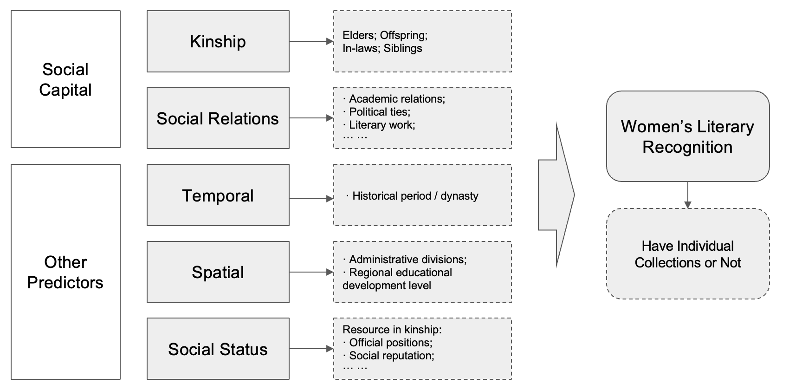

\counterwithin{figure}{section}
\counterwithin{table}{section}
\setcounter{tocdepth}{3} 
\setcounter{secnumdepth}{3} 
\renewcommand{\thesection}{\arabic{section}} 
\renewcommand{\thesubsection}{\arabic{section}.\arabic{subsection}} \renewcommand{\thesubsubsection}{\arabic{section}.\arabic{subsection}.\arabic{subsubsection}}
\setstretch{1.5} 
\lstset{
            basicstyle=\linespread{1.0}\ttfamily, 
            columns=fullflexible
          }
\pagenumbering{gobble}

```{=html}
<style>
  body {
  text-align: justify}
</style>
```


```{r setup}
#| include: FALSE
#| warning: false
#| message: false

knitr::opts_chunk$set(echo = FALSE, 
                      #include = TRUE, 
                      fig.width = 12, fig.height = 9,
                      warning = FALSE,
                      message = FALSE,
                      cache = TRUE,
                      digits = 3,
                      width = 48) 

#-------------------------------
# load hanzi font
#-------------------------------
source("r/_theme.R")
source("r/_networks_degree.R")
library(showtext)
## Add the font with the corresponding font faces
font_add("Canger", "/Library/Fonts/仓耳今楷01-W04.ttf")
font_families()
showtext_auto()  

#-------------------------------
# load packages
#-------------------------------

library(DBI)
library(RSQLite)
library(ggplot2)
library(dplyr)
library(tidyverse)
library(magrittr)
library(kableExtra)

library(data.table)
library(magrittr)
library(tidyverse)
library(dplyr)

library(gridExtra)
library(grid)

library(igraph)
library(ggraph)
```


A preprint version of this manuscript is available at [SSRN](https://papers.ssrn.com/sol3/papers.cfm?abstract_id=5072945)

\pagenumbering{arabic}

# Introduction

In imperial China, women’s access to cultural prestige and literary achievement was highly constrained by gendered norms, Confucian hierarchy, and limited access to formal institutions. Yet despite these structural restrictions, a number of women poets managed to attain significant literary recognition, even publishing individual poetry collections (bieji/別集) that showcased their unique voices. This study investigates how such success was made possible—not through institutional power, but through social capital embedded in networks of personal relationships, particularly with male elites.

This research explores how social capital functioned as a risk management strategy for women navigating a patriarchal literary world. Without institutional authority or formal professional pathways, women relied on their kinship ties and non-kin social networks to gain visibility, publish their works, and secure cultural legitimacy. This form of network-based agency—sometimes subtle and informal—played a critical role in shaping women’s careers in literature.

This project uses a quantitative approach to test the impact of different forms of social capital on women’s literary recognition. Drawing on the China Biographical Database (CBDB) [@cbdb] and Ming Qing Women’s Writings archive [@mqww], I construct network measures of kinship and social relations and evaluate their effects through LASSO and double LASSO regression models. The outcome variable is whether a woman poet published her own individual collection, which is taken as an indicator of professional literary recognition.

The findings suggest that non-kin social networks, rather than familial ties, were more influential in determining women’s literary visibility. This result challenges traditional assumptions that family support alone was sufficient, and instead highlights how women strategically engaged in wider social relations—such as academic correspondence, artistic exchange, and political ties—to navigate and overcome the risks of marginalization. Ultimately, this study contributes to the growing literature on gender, networks, and cultural production, while offering new insights into the strategies women used to transform social connection into professional capital in a restrictive historical context.

# Theoretical Framework

## Classical Theories of Social Capital

This study adopts social capital theory as its primary analytical lens to investigate how women poets in imperial China gained literary recognition. The foundational concept of social capital was developed by Pierre Bourdieu, who defined it as “the aggregate of the actual or potential resources linked to possession of a durable network of more or less institutionalized relationships” [@bourdieu1986forms]. Social capital, according to Bourdieu, functions as a key mechanism of social reproduction and inequality. Building on this, Coleman emphasized that social capital within closed networks fosters trust and facilitates resource sharing, which is particularly significant in traditional societies like imperial China [@coleman1988social].

In the context of this research, social capital is operationalized through two dimensions: kinship ties (family-based capital) and non-kin social relations (e.g., academic, political, and artistic interactions). While kinship often shaped women’s initial access to resources, this study explores how non-familial social connections provided unique and often more effective pathways to literary visibility.

Western theories of social networks further illuminate the dynamics at play. Granovetter’s seminal theory of “The Strength of Weak Ties” proposes that loosely connected individuals play a crucial role in spreading information and creating new opportunities [@granovetter1973strength]. Burt’s structural hole theory underscores how individuals who bridge disconnected groups within networks gain competitive advantages through access to diverse resources [@burt1992structural]. Though grounded in modern Western societies, these theories offer useful frameworks for examining elite cultural production in imperial China.

## Social Capital in the Chinese Context

In the Chinese context, Lin argues that access to social resources is embedded in hierarchical structures, and that an individual’s position within these networks significantly affects their opportunity structures [@lin2001social]. Bian’s research adds a culturally specific perspective, showing that in Chinese society, strong ties and direct personal connections—or guanxi—were often more influential than weak ties, especially in resource acquisition and career advancement [@bian1997bringing].

## Gendered Networks in Historical China

Historical studies provide additional insight into gendered social capital in China. Ko highlights how educated women in the Ming-Qing era formed learning communities and literary circles within elite households [@ko1994teachers]. Mann reveals that women leveraged marriage alliances and cross-family connections to construct female-centered intellectual spaces [@mann1997precious]. Other scholars, such as Wu, Robertson, and Fong, document the vibrant female poetic and artistic networks that emerged in urban centers like Suzhou and Hangzhou, despite gendered spatial constraints [@wu2003confucians; @robertson1992art; @fong2004female].

Beyond the literary sphere, demographic and economic histories of China also reveal the deep-rooted influence of kinship networks in shaping individual life chances. Campbell and Lee’s study of Liaoning during the Qing Dynasty (1749–1909) demonstrates that household structure and kinship composition were critical to survival and social mobility, underscoring the structural importance of family-based social capital in everyday life [@campbell2000state]. Similarly, Zelin’s examination of Zigong salt merchants from the late Ming to Republican period shows how family networks sustained intergenerational business success through the strategic transmission of capital and trust, highlighting the institutional role of kinship in traditional economic networks [@zelin2005merchants]. Deng and Treiman further illustrate how lineage organizations in the late Qing to early Republican era served as powerful conduits for educational attainment and career advancement, particularly in male-dominated spheres such as the imperial examination and bureaucracy [@deng2008impact].

Taken together, these studies emphasize that kinship ties were not only familial but also institutionalized mechanisms of social reproduction. However, in contrast to these male-centered patterns, the findings of this research suggest that for women—especially in cultural fields like literature—non-kin social capital may have provided more flexible and effective pathways for public recognition. This gendered divergence in network utility provides an important perspective on how women navigated societal constraints through alternative social strategies.

## Research Gap and Analytical Approach

Nevertheless, prior research has faced two key limitations: (1) the difficulty of quantifying social capital in historical contexts, and (2) the challenge of separating familial influence from broader social ties. This study addresses these gaps by leveraging two digital databases—the China Biographical Database (CBDB) and Ming Qing Women’s Writings (MQWW)—to build large-scale social networks and quantify their effects on women’s literary recognition. Using a three-step regression model including LASSO and double LASSO, this study provides robust empirical evidence that non-kin social relations, rather than kinship ties, were the more critical drivers of women’s success in achieving literary prominence.

In sum, social capital theory offers a powerful framework for analyzing how women in patriarchal societies navigated structural limitations. It reveals how non-inherited, strategically cultivated social ties served as essential vehicles for women to access cultural capital, gain recognition, and establish a legacy in the male-dominated literary sphere of imperial China.

```{r cbdb}
#| message: FALSE
#| warning: false

#-------------------------------
# load the datatable
#-------------------------------

filename <- '/Users/sousekilyu/Documents/Meta Data/CBDB/cbdb202409.db'
sqlite.driver <- dbDriver("SQLite")
db <- dbConnect(sqlite.driver,
                dbname = filename)
df_ADDR_XY <- dbReadTable(db, "ADDR_XY")  
df_DYNASTIES <- dbReadTable(db, "DYNASTIES")  
source("r/_cbdb_read.R")
source("r/_cbdb_networks.R")
```

```{r mqww}
#| message: FALSE
#| echo: false
#| warning: false
#| include: false

###
df.poem.poet.info <- fread('/Users/sousekilyu/Documents/Meta Data/CBDB/mqww/cycle/poem.csv') %>%
  left_join(df.poem.poet, join_by(poemID == poemID)) %>%
  left_join(df.poem.work, join_by(poemID == poemID)) %>%
  left_join(df.work, join_by(workID == workID)) %>%
  inner_join(df.poet, join_by(poetID == poetID))


df.poem.sum <- df.poem.poet.info %>%
  filter(Sex == "女") %>%
  group_by(worktype, poetID, NameHZ, NamePY) %>%
  summarise(n = n_distinct(poemID)) %>%
  filter(worktype %in% c("別集", "總集"))
```


# Data and Variables

This study uses two main historical databases to analyze how social networks affected women poets’ literary recognition in ancient China. [The China Biographical Database (CBDB)](https://projects.iq.harvard.edu/cbdb) provides detailed information on over 640,000 individuals from the 7th to 19th centuries, including their social connections, official positions, and family background [@cbdb]. [Ming Qing Women's Writing (MQWW)](https://digital.library.mcgill.ca/mingqing/english/index.php) database contains poetry and other writings by women from the late imperial to modern period.

These two datasets were linked to identify women poets and explore their connections with male elites. SQL queries were used to clean and extract key information such as social ties and publication records. Together, the data offer a rich foundation for analyzing the role of social capital in shaping women’s access to literary recognition.

## Response: Women's Literary Recognition

My response variable to measure women's literary recognition is whether women poets have published their own individual collections (Bieji/別集). Anthologies (Zongji/總集, including all of other worktypes) typically include works that are representative or influential, but they do not fully reflect the complete body of work and value of an individual author. In contrast, individual collections better showcase the personal creative characteristics and literary styles of a specific writer, and can better demonstrate their unique literary achievements.

Compared to anthologies, which tend to reflect the mainstream evaluation standards of the literary community at the time and are often biased towards male perspectives, the curation of individual collections is more likely to focus on the personal writings of women authors, highlighting their unique perspectives and modes of expression. This makes individual collections more conducive to the objective assessment of the status of women's literary works.

Therefore, **if a woman poet has published at least one individual collection (Bieji > 0), I will conclude that her literary status has been recognized**.

$$
Y = I (Bieji > 0)
$$

Where:

- $Y$ represents the response variable of women's literary recognition
- $I$ is the indicator function, which takes the value of 1 if the condition $Bieji > 0$ is true, and 0 otherwise.

The plot (@fig-worktype) on the right illustrates that while most women poets have published anthologies, only 27% have produced individual collections, highlighting a significant disparity in literary recognition.

```{r womendata}

#-------------------------------
# clean data
#-------------------------------

filtered_data <- df_BIOG_MAIN %>%
  dplyr::filter(c_female == 1) %>%
  dplyr::select(c_personid, c_name, c_name_chn, c_birthyear, c_index_year) 
  
combine_data <- df.poet %>%
  filter(Sex == "女") %>%
  select(poetID, NameHZ, NamePY, 
         StartYear, EndYear) %>%
  left_join(filtered_data, by = c("NameHZ" = "c_name_chn")) 

female.poet.df <- combine_data %>%
  group_by(poetID) %>%
  mutate(n = row_number(desc(ifelse(is.na(c_index_year), 
                                    -Inf, c_index_year)))) %>%
  group_by() 

## birthday
female.poet.df.birth <- female.poet.df %>%
  filter((StartYear == c_birthyear | between(StartYear, c_birthyear-50, c_birthyear+50)) & !is.na(c_birthyear))

## duplicate
unique.df <- female.poet.df %>%
  filter(n > 1)


#-------------------------------
# Clean Women Data
#-------------------------------

## new data
df.poet.new <- rbind(female.poet.df.birth, unique.df) %>%
  mutate(diff = c_birthyear - StartYear) %>%
  group_by(poetID) %>%
  mutate(n = row_number((ifelse(is.na(diff), 
                                    Inf, diff)))) %>%
  filter(n == 1, diff < 100) %>%
  select(poetID, NameHZ, NamePY, c_personid, StartYear) %>%
  ungroup() %>%
  filter(StartYear > 0)

```
            
```{r fig-worktype}
#| out.width: '100%'
#| fig.width: 12
#| fig.height: 6
#| fig.align: 'center'
#| fig.cap: "Poem and Poet Number against Worktypes"
#| label: fig-worktype

#-------------------------------
# plot
#-------------------------------

df.poem.sum.new <- df.poet.new %>%
  select(poetID, c_personid) %>%
  left_join(df.poem.poet.info, by = "poetID") %>%
  group_by(worktype, poetID, NameHZ, NamePY) %>%
  summarise(n_poem = n_distinct(poemID)) %>%
  ungroup()
  # filter(worktype %in% c("別集", "總集"))

df.poet.sum.new <- df.poet.new %>%
  select(poetID, c_personid) %>%
  left_join(df.poem.poet.info, by = "poetID") %>%
  group_by(worktype) %>%
  summarise(n_poet = n_distinct(poetID)) %>%
  ungroup()
  # filter(worktype %in% c("別集", "總集"))

## poem number
worktype_labels <- c(
    "傳" = "Biography
(傳)",
    "別集" = "Individual Collections
(別集)",
    "合刻" = "Joint Publications
(合刻)",
    "彈詞" = "Tanci
(彈詞)",
    "總集" = "Anthology
(總集)",
    "詩話" = "Poetry Criticism
(詩話)",
    "NA" = "NA"
)

# NA
df.poem.sum.new <- df.poem.sum.new %>%
  filter(!is.na(worktype))

df.poet.sum.new <- df.poet.sum.new %>%
  filter(!is.na(worktype)) %>%
  mutate(percentage = n_poet / sum(n_poet) * 100)

df.poem.sum.new <- df.poem.sum.new %>%
  mutate(worktype = reorder(worktype, n_poem, median))

df.poet.sum.new <- df.poet.sum.new %>%
  mutate(worktype = reorder(worktype, n_poet))

p1 <- ggplot(df.poem.sum.new, aes(x = worktype, y = n_poem)) +
  geom_violin(aes(fill = worktype == "別集"), scale = "width", alpha = .7) +
  geom_boxplot(width = 0.1, fill = "white", alpha = 0.5) +
  labs(
    title = "Poem Number against Work Type",
    x = "Work Type",
    y = "Poem Number",
    fill = "Work Type"
  ) +
  scale_fill_manual(values = c("lightskyblue", "darkorange")) +
  scale_x_discrete(labels = worktype_labels) +
  ylim(c(0, 500)) +
  theme_minimal() +
  theme_common() +
  theme(
    legend.position = "none",
    axis.text.x = element_text(angle = 45, hjust = 1)
  ) +
  geom_hline(yintercept = 0.5, linetype = "dashed", color = "red", alpha = 0.5)

p2 <- ggplot(df.poet.sum.new, aes(x = worktype, y = n_poet)) +
  geom_col(aes(fill = worktype == "別集"), alpha = 0.7) +
  geom_text(aes(label = sprintf("%.1f%%", percentage), 
                y = n_poet + max(n_poet) * 0.03),
            size = 5) +
  labs(
    title = "",
    x = "Work Type",
    y = "Poet Number",
    fill = "Gender"
  ) +
  scale_fill_manual(values = c("lightskyblue", "darkorange")) +
  scale_x_discrete(labels = worktype_labels) +
  theme_minimal() +
  theme_common() +
  theme(
    legend.position = "none",
    axis.text.x = element_text(angle = 45, hjust = 1)
  )

grid.arrange(p1, p2, ncol = 2)

```

The analytical framework of this study is as follows (@fig-structure). The primary predictor is social capital, which is divided into two components: kinship and social relations. Kinship focuses on social capital based on blood relations, while social relations focus on non-kinship and non-inherited social capital. In addition to these primary predictors, the study will also control for other major variables that may potentially influence the outcome variable (women's literary recognition). The measurement approaches for these other variables will be detailed in the subsequent sections.

{#fig-structure}

## Summary of Other Predictors

In addition to social capital, other predictors are also controlled for within the model. Regarding the temporal dimension, the distribution of women poets spans various historical periods, from the Eastern Han to the Qing Dynasty. As differing influences may be exerted by different dynasties, the dynasty is considered an important variable.

In terms of the spatial dimension, the administrative provinces of the women poets' birthplaces were accounted for, as some provinces had significantly more women poets than others, which can be attributed to the structural mechanisms within those regions. Furthermore, local education levels were controlled by examining the number of successful candidates (also known as palace graduates, specifically jinshi 進士, juren 舉人, or jieyuan 解元) within a 50 km radius of the women poets' birthplaces, an area roughly equivalent to the same administrative region. A higher number of local palace graduates can be interpreted as an indication of more advanced education in that area.

In assessing social status, the highest social status attained by the family members of women poets was considered. This approach is justified for two primary reasons: First, women in ancient China had limited opportunities to acquire social resources, as their status was often linked to their family members, particularly male relatives  (as reflected in the saying "未嫁从父/出嫁从夫/夫死从子," which translates to "before marriage, obey your father; after marriage, obey your husband; after his death, obey your son"). Second, the highest social status of family members serves as an indicative measure of the resources that women poets could potentially access.

The detailed measurement involves identifying family members based on the following criteria: 1. whether they have been recorded biographically as core figures; 2. whether they held the status of palace graduates; 3. whether they held official positions; 4. whether they received official honors or recognitions; and 5. whether they were distinguished writers or historians.

## Primary Predictor: Social Capital

As mentioned, this study measures social capital through kinship and social relationships. Specifically, the kinship networks consist solely of immediate relatives, which include Ascending Kin, Descending Kin, Affinal Kin, and Collateral Kin. In contrast, social relations encompass ten different types of relationships defined in previous studies, such as Academic Relations, Political Ties, Patronage, Social Network, Literary Work, Artistic Exchange, Ceremonial Ties, Correspondence, Service Links, and Economic Ties.

```{r loadnetworkdata}

# df.network.1 <- data.frame()
# df.network.2 <- data.frame()
# # 
# poet_ids <- df.poet.new$c_personid
# for(i in 1:length(poet_ids)) {
#   id = poet_ids[i]
#   .network_1 <- get_network(id, degree = 1)
#   .network_2 <- get_network(id, degree = 2)
#   df.network.1 <- rbind(df.network.1, .network_1)
#   df.network.2 <- rbind(df.network.2, .network_2)
#   print(i)
# }
# # 181 186
# save(df.network.1, file = "data/df.network.1.Rda")
# save(df.network.2, file = "data/df.network.2.Rda")

load("data/df.network.1.Rda")
load("data/df.network.2.Rda")

```

```{r cleannetworks}
#| warning: FALSE

#-------------------------------
# Networks Join
#-------------------------------

df.poet.networks <- df.poet.new %>%
  left_join(df.network.1 %>%
              mutate(from = as.character(from),
                     to = as.character(to)),
            by = c("c_personid" = "from")) %>%
  left_join(df_BIOG_MAIN %>%
              select(c_personid, c_name, c_name_chn, c_female) %>%
              unique(),
            by = c("to" = "c_personid")) %>%
  # only observe male networks
  filter(c_female == 0) %>%
  # is_bieji
  left_join(df.poem.poet.info %>%
              select(poetID, worktype) %>%
              unique() %>%
              mutate(is_bieji = ifelse(worktype == "別集", 1, 0)) %>%
              group_by(poetID) %>%
              summarise(is_bieji = sum(is_bieji, na.rm = TRUE)) %>%
              ungroup(), 
            by = "poetID") 

df.poet.networks.unique <- df.poet.networks %>%
  select(from = c_personid,
         from_name_ch = NameHZ,
         from_name = NamePY,
         to = to,
         to_name = c_name,
         to_name_ch = c_name_chn,
         type) %>%
  unique()
```

Here is an overview of women poets' social networks. The network adjacency matrices (@fig-net-1) illustrate the connections among women poets, with the x-axis representing the poets themselves and the y-axis indicating their relationships with specific individuals. The matrix on the left focuses on kinship relations, while the one on the right emphasizes social relations. @tbl-net presents the descriptive statistics for connections among women poets based on two relationship types. Overall, the data indicates that social relations exhibit a greater mean number of connections than kinship ties, suggesting a richer network among women poets in terms of social relationships (It is mainly due to social ties containing more kinds of relationships selected). 

```{r fig-net-1}
#| warning: FALSE
#| out.width: '100%'
#| fig.width: 12
#| fig.height: 6
#| fig.align: 'center'
#| fig.cap: "Adjacency Matrices of Women Poets (Source: CBDB)"
#| label: fig-net-1
 
#-------------------------------
# Plot Networks
#-------------------------------

#-------------------------------
# Kinship Relations
#-------------------------------

adj_matrix_tidy_kin <- df.poet.networks.unique %>%
  filter(type == 1) %>%
  select(from, to) %>%
  table() %>%
  as.matrix()

adj_kin_df <- adj_matrix_tidy_kin %>%
  as.table() %>%
  as.data.frame() %>%
  mutate(value = ifelse(Freq > 0, 1, 0))

p1 <- ggplot(adj_kin_df, aes(x = from, y = to)) +
  geom_tile(aes(fill = factor(value))) +  
  scale_fill_manual(
    values = c("0" = "black", "1" = "yellow")  
  ) +
  theme_minimal() +
  theme_common() +
  xlab("Women Poets") +
  ylab("Kinship Relations") +
  guides(fill = "none") +
  theme(
    axis.text.x = element_blank(),
    axis.text.y = element_blank(),
    panel.background = element_rect(fill = "black"),
    # plot.background = element_rect(fill = "black"),
    panel.grid = element_blank(),
    # text = element_text(color = "white"),
    aspect.ratio = 1
  ) +
  labs(title = "Kinship Networks",
       fill = "Connection") 

ggsave("output/images/p-1.tiff", 
       p1,
       width = 6,      
       height = 6,
       dpi = 300)

#-------------------------------
# Social Relations
#-------------------------------

adj_matrix_tidy_social <- df.poet.networks.unique %>%
  filter(type == 2) %>%
  select(from, to) %>%
  table() %>%
  as.matrix()

adj_social_df <- adj_matrix_tidy_social %>%
  as.table() %>%
  as.data.frame() %>%
  mutate(value = ifelse(Freq > 0, 1, 0))

adj_social_df <- adj_kin_df %>%
  dplyr::select(from) %>%
  unique() %>%
  left_join(adj_social_df)

p2 <- ggplot(adj_social_df, aes(x = from, y = to)) +
  geom_tile(aes(fill = factor(value))) +  
  scale_fill_manual(
    values = c("0" = "black", "1" = "yellow")  
  ) +
  theme_minimal() +
  theme_common() +
  xlab("Women Poets") +
  ylab("Social Relations") +
  guides(fill = "none") +
  theme(
    axis.text.x = element_blank(),
    axis.text.y = element_blank(),
    panel.background = element_rect(fill = "black"),
    # plot.background = element_rect(fill = "black"),
    panel.grid = element_blank(),
    # text = element_text(color = "white"),
    aspect.ratio = 1
  ) +
  labs(title = "Social Networks",
       fill = "Connection") 


all_from <- unique(adj_kin_df$from)  
all_to <- unique(adj_social_df$to)   

complete_df <- expand.grid(
  from = all_from,
  to = all_to
) %>%
  left_join(adj_social_df)

p2 <- ggplot(complete_df, aes(x = from, y = to)) +
  geom_tile(aes(fill = factor(value)), color = NA) +  
  scale_fill_manual(
    values = c("0" = "black", "1" = "yellow"),
    na.value = "black"  
  ) +
  theme_minimal() +
  theme_common() +
  xlab("Women Poets") +
  ylab("Social Relations") +
  guides(fill = "none") +
  theme(
    axis.text.x = element_blank(),
    axis.text.y = element_blank(),
    panel.background = element_rect(fill = "black"),
    # plot.background = element_rect(fill = "black"),
    panel.grid = element_blank(),
    # text = element_text(color = "white"),
    aspect.ratio = 1
  )  +
  labs(title = "Social Networks",
       fill = "Connection") 

ggsave("output/images/social p-2.tiff", 
       p2,
       width = 6,      
       height = 6,
       dpi = 300)

grid.arrange(p1, p2, ncol = 2)

# g <- arrangeGrob(p1, p2, ncol = 2)
# grid.newpage()
# grid.rect(gp = gpar(fill = "black", col = "black"))  
# grid.draw(g)
```

```{r tbl-net}
#| warning: FALSE
#| label: tbl-net
#| tbl-cap: "Descriptive Statistics of Connections by Relationship Type"

#-------------------------------
# describe
#-------------------------------
from_type_counts <- df.poet.networks.unique %>%
  # is_bieji
  left_join(unique(select(df.poet.networks, c_personid, is_bieji)),
            by = c("from" = "c_personid")) %>%
  mutate(is_bieji = ifelse(is.na(is_bieji), 0, is_bieji)) %>%
  group_by(from, from_name_ch, type, is_bieji) %>%
  summarise(connections = n()) %>%
  ungroup() %>%
  mutate(
    relation_type = case_when(
      type == 1 ~ "Kinship",
      type == 2 ~ "Social Relations",
      TRUE ~ "Other"
    ),
    relation_type = factor(relation_type, levels = c("Kinship", "Social Relations", "Both", "Other"))
  )

connection_stats <- from_type_counts %>%
  group_by(relation_type) %>%
  summarise(
    count = n(),
    mean = mean(connections),
    sd = sd(connections),
    median = median(connections),
    min = min(connections),
    max = max(connections),
    q25 = quantile(connections, 0.25),
    q75 = quantile(connections, 0.75)
  ) %>%
  mutate(across(where(is.numeric), ~round(., 2))) %>%
  arrange(desc(mean))

library(kableExtra)
connection_stats %>%
  kable(
    col.names = c(
      "Relationship Type", "N", "Mean", "SD", "Median",
      "Min", "Max", "Q25", "Q75"
    ),
    caption = "Descriptive Statistics of Connections by Relationship Type"
  ) 
  # kable_styling(
  #   bootstrap_options = c("striped", "hover", "condensed"),
  #   full_width = FALSE,
  #   position = "left"
  # ) %>%
  # row_spec(0, bold = TRUE, background = "#E8E8E8") %>%
  # column_spec(1, width = "150px", bold = TRUE) %>%
  # column_spec(2:3, width = "100px") 

connection_stats %>%
  kable(
    format = "latex",  
    booktabs = TRUE,
    col.names = c(
      "Relationship Type", "N", "Mean", "SD", "Median",
      "Min", "Max", "Q25", "Q75"
    ),
    caption = "Descriptive Statistics of Connections by Relationship Type",
    label = "tbl_connection_stats",
    digits = 2  
  ) %>%
  writeLines(., "output/tables/tbl_connection_stats.tex")

#-------------------------------
# from
#-------------------------------

top_from_connections <- df.poet.networks.unique %>%
  select(-type) %>%
  unique() %>%
  group_by(from, from_name, from_name_ch) %>%
  summarise(
    total_connections = n()
  ) %>%
  arrange(desc(total_connections)) %>%
  ungroup()%>%
  head(10)

popular_to_nodes <- df.poet.networks.unique %>%
  select(-type) %>%
  unique() %>%
  group_by(to, to_name, to_name_ch) %>%
  summarise(
    connected_from_count = n_distinct(from),
    total_connections = n()
  ) %>%
  arrange(desc(total_connections)) %>%
  ungroup()%>%
  head(10)

library(kableExtra)

top_from_table <- top_from_connections %>%
  mutate(Rank = row_number()) %>%
  select(
    Rank,
    `Chinese Name` = from_name_ch,
    `Pinyin Name` = from_name,
    `Total Connections` = total_connections
  ) %>%
  kable(
    caption = "Top 10 Most Connected Women Poets (From)",
    align = c('c', 'l', 'l', 'c')
  ) 
  # kable_styling(
  #   bootstrap_options = c("striped", "hover", "condensed"),
  #   full_width = FALSE,
  #   position = "left"
  # ) %>%
  # row_spec(0, bold = TRUE, background = "#E8E8E8") %>%
  # column_spec(1, width = "50px", bold = TRUE) %>%
  # column_spec(2:4, width = "150px")

# Top 10 Most Connected To Nodes
popular_to_table <- popular_to_nodes %>%
  mutate(Rank = row_number()) %>%
  select(
    Rank,
    `Chinese Name` = to_name_ch,
    `Pinyin Name` = to_name,
    # `Connected From Count` = connected_from_count,
    `Total Connections` = total_connections
  ) %>%
  kable(
    caption = "Top 10 Most Connected Recipients (To)",
    align = c('c', 'l', 'l', 'c'),
    escape = FALSE
  ) 
  # kable_styling(
  #   bootstrap_options = c("striped", "hover", "condensed"),
  #   full_width = FALSE,
  #   position = "left"
  # ) %>%
  # row_spec(0, bold = TRUE, background = "#E8E8E8") %>%
  # column_spec(1, width = "50px", bold = TRUE) %>%
  # column_spec(2:4, width = "150px") 


```

```{r fig-net-2}
#| warning: FALSE
#| include: FALSE
#| out.width: '100%'
#| fig.width: 12
#| fig.height: 6
#| fig.align: 'center'
#| fig.cap: "Descriptive Statistics of Women Poets' Connections by Relationship Type"
#| label: fig-net-2
 
# 1. Violin Plot
from_type_counts %>%
  ggplot(aes(
    x = as.factor(relation_type),
    y = connections
  )) +
  geom_violin(fill = "lightgray") +
  geom_jitter(
    width = 0.2, color = "darkred",
    size = 3, alpha = 0.7
  ) +
  geom_hline(yintercept = 0, linetype = "dashed") +
  stat_summary(fun = mean, geom = "point", size = 3, color = "black") +
  stat_summary(
    fun.data = function(x) {
      data.frame(
        y = 20, 
        label = sprintf("Mean: %.3f", mean(x))
      )
    },
    geom = "label",
    color = "black",
    fill = "white",
    label.padding = unit(0.5, "lines"),
    label.size = 0.5,
    size = 5
  ) +
  facet_wrap(~is_bieji, 
             labeller = labeller(is_bieji = c(
               "1" = "Bieji",
               "0" = "Non-Bieji"
             ))) +
  coord_cartesian(clip = "off") + 
  theme_common() +
  labs(
    title = "Distribution of Connections by Relationship Type",
    x = "Relationship Type",
    y = "Number of Connections"
  )
# ggsave("output/images/fig-net-2.pdf", dpi = 300)
```

```{r fig-dynasty}
#| warning: FALSE
#| include: FALSE
#| out.width: '100%'
#| fig.width: 12
#| fig.height: 6
#| fig.align: 'center'
#| fig.cap: "Distribution of Women Poets across Dynasties"
#| label: fig-dynasty

df.poet.dynasty <- df.poet.new %>%
  left_join(dplyr::select(df_BIOG_MAIN, 
                          c_personid, c_dy), by = "c_personid") %>%
  left_join(dplyr::select(df_DYNASTIES, 
                          c_dy, c_dynasty, c_dynasty_chn, c_sort), 
            by = "c_dy")

df.poet.dynasty.sum <- df.poet.dynasty %>%
  group_by(c_dy, c_dynasty, c_dynasty_chn, c_sort) %>%
  summarise(n_poet = n_distinct(poetID)) %>%
  ungroup() %>%
  arrange(c_sort) %>%
  filter(!(c_dy %in% c(21, 22)))%>%
  mutate(dynasty_label = paste0(c_dynasty, "
\n(", c_dynasty_chn, ")")) %>%
  mutate(dynasty_label = factor(dynasty_label, 
                               levels = dynasty_label[order(c_sort)])) %>%
  mutate(percentage = n_poet / sum(n_poet) * 100,
         percentage_label = sprintf("%.1f%%", percentage))

#-------------------------------
# plot
#-------------------------------

ggplot(df.poet.dynasty.sum, aes(x = dynasty_label, y = n_poet)) +
  geom_col(alpha = 0.7, fill = "steelblue") +
  geom_text(aes(label = percentage_label), 
            position = position_stack(vjust = 1.05),  
            size = 5) + 
  labs(
    title = "Distribution of Women Poets across Dynasties",
    x = "Dynasty",
    y = "Number of Poets"
  ) +
  theme_minimal() +
  theme_common() +
  theme(
    axis.text.x = element_text(angle = 45, hjust = 1)  
  )

```

```{r fig-region}
#| warning: FALSE
#| message: FALSE
#| include: FALSE
#| out.width: '100%'
#| fig.width: 12
#| fig.height: 6
#| fig.align: 'center'
#| fig.cap: "Spatial Distribution of Women Poet by Province (Source: CBDB)"
#| label: fig-region

#-------------------------------#
# bg map and bbox ----
#-------------------------------#

library(ggplot2)
library(sf)
library(rnaturalearth)

china_map <- ne_countries(
  scale = "medium",
  returnclass = "sf",
  country = c(
    "China", "Mongolia", "North Korea",
    "South Korea", "Japan", "Vietnam",
    "Laos", "Myanmar", "Taiwan"
  )
)

load("data/provincial_shape.Rda")

china_map_transformed <- china_map %>%
  st_transform(crs = 2333)

bbox_sf <- st_make_grid(
  cellsize = c(22, 18), 
  offset = c(103, 22), 
  n = c(1, 1) 
) %>%
  st_set_crs(4326) %>%
  st_transform(2333) %>%
  st_bbox()

#-------------------------------
# poets' location
#-------------------------------

poets_locations <- df.poet.new %>%
    left_join(
      df_BIOG_ADDR_DATA %>%
        filter(between(c_addr_type, 1, 10)) %>%  
        group_by(c_personid) %>%
        slice(which.min(c_addr_type)) %>%  
        ungroup() %>%
        select(c_personid, c_addr_id = c_addr_id),
      by = "c_personid"
    ) %>%
    left_join(
      df_ADDR_CODES %>%
        select(c_addr_id, c_name_chn = c_name_chn, c_name),
      by = "c_addr_id"
    ) %>%
    left_join(
      df_ADDR_XY %>%
        select(c_addr_id, x_coord, y_coord),
      by = "c_addr_id"
    )

#-------------------------------#
# Combine and Plot ----
#-------------------------------#

poets_sf <- poets_locations %>%
  filter(!is.na(x_coord) & !is.na(y_coord)) %>%
  st_as_sf(coords = c("x_coord", "y_coord"), crs = 4326) %>%
  st_transform(2333)

df.poet.province <- st_join(poets_sf, provincial_shape) %>%
  as.data.frame() %>%
  select(c_personid, ENG_NAME)

poets_by_province <- st_join(poets_sf, provincial_shape) %>%
  as.data.frame() %>%
  count(ENG_NAME) %>%
  arrange(desc(n))

# poets
poets_sf <- poets_locations %>%
  filter(!is.na(x_coord), !is.na(y_coord)) %>%
  st_as_sf(
    coords = c("x_coord", "y_coord"),
    crs = 4326
  ) %>%
  st_transform(crs = 2333) %>%
  mutate(
    coords = st_coordinates(.),
    lon = coords[, "X"],
    lat = coords[, "Y"]
  ) %>%
  filter(
    between(lon, bbox_sf["xmin"], bbox_sf["xmax"]),
    between(lat, bbox_sf["ymin"], bbox_sf["ymax"])
  ) %>%
  as.data.frame()

p1 <- ggplot() +
  geom_sf(
    data = china_map_transformed,
    fill = "#F2EFDB",
    color = "black",
    size = 0.5
  ) +
  geom_sf(
    data = provincial_shape,
    fill = NA,
    color = "black",
    linetype = "dashed",
    size = 0.2
  ) +
  geom_point(
    data = poets_sf,
    aes(x = lon, y = lat),
    color = "darkred",
    alpha = 0.7
  ) +
  coord_sf(
    xlim = bbox_sf[c("xmin", "xmax")],
    ylim = bbox_sf[c("ymin", "ymax")]
  ) +
  guides(fill = "none") +
  ylab("") +
  xlab("") +
  theme_minimal() +
  labs(
    title = "Spatial Distribution of Women Poets",
    subtitle = "Women Poets Birthplaces",
    fill = "Density"
  ) +
  theme_common() +
  theme(
    panel.grid.major = element_line(color = "gray90", size = 0.2),
    panel.grid.minor = element_blank()
  )


p2 <- ggplot(poets_by_province[which(!is.na(poets_by_province$ENG_NAME)),], 
             aes(x = reorder(ENG_NAME, n), y = n)) +
  geom_col(fill = "steelblue", alpha = 0.7) +
  geom_text(aes(label = n), 
            hjust = -0.2,
            size = 3) +
  coord_flip() +
  labs(
    title = "",
    subtitle = "Count by Province",
    x = "Province",
    y = "Count"
  ) +
  theme_minimal() +
  theme_common() +
  theme(
    axis.text.y = element_text(size = 13),
    aspect.ratio = 1
  )

grid.arrange(p1, p2, ncol = 2)

```

```{r fig-jinshi}
#| warning: FALSE
#| message: FALSE
#| include: FALSE
#| out.width: '100%'
#| fig.width: 12
#| fig.height: 6
#| fig.align: 'center'
#| fig.cap: "Spatial Distribution of Palace Graduates Birthplaces (Source: CBDB)"
#| label: fig-jinshi

# source("r/_get_jinshi.R")
# jinshi_results <- get_jinshi_geography(min(df.poet.new$StartYear),
#                                        max(df.poet.new$StartYear))
# save(jinshi_results, file = "data/jinshi_results.Rda")
load("data/jinshi_results.Rda")


#-------------------------------
# plot of jinshi
#-------------------------------

# jinshi
jinshi_sf <- jinshi_results %>%
  filter(!is.na(x_coord), !is.na(y_coord)) %>%
  st_as_sf(
    coords = c("x_coord", "y_coord"),
    crs = 4326
  ) %>% # 
  st_transform(crs = 2333) %>%
  mutate(
    coords = st_coordinates(.),
    lon = coords[, "X"],
    lat = coords[, "Y"]
  ) %>%
  filter(
    between(lon, bbox_sf["xmin"], bbox_sf["xmax"]),
    between(lat, bbox_sf["ymin"], bbox_sf["ymax"])
  ) %>%
  as.data.frame()


#-------------------------------
# Plot spatial dis
#-------------------------------

p2 <- ggplot() +
  geom_sf(
    data = china_map_transformed,
    fill = "#F2EFDB",
    color = "black",
    size = 0.5
  ) +
  geom_sf(
    data = provincial_shape,
    fill = NA,
    color = "black",
    linetype = "dashed",
    size = 0.2
  ) +
  stat_density_2d_filled(
    data = jinshi_sf,
    aes(x = lon, y = lat),
    alpha = 0.7,
    # bins = 50,
    # bandwidth = 100000,
    contour_var = "ndensity", 
    breaks = seq(0.1, 1, length.out = 20)
  ) +
  # scale_fill_viridis_c(option = "magma", alpha = 0.7) +
  coord_sf(
    xlim = bbox_sf[c("xmin", "xmax")],
    ylim = bbox_sf[c("ymin", "ymax")]
  ) +
  guides(fill = "none") +
  ylab("") +
  xlab("") +
  theme_minimal() +
  labs(
    title = "",
    subtitle = "Density Map",
    fill = "Density"
  ) +
  theme_common() +
  theme(
    panel.grid.major = element_line(color = "gray90", size = 0.2),
    panel.grid.minor = element_blank()
  )


p1 <- ggplot() +
  geom_sf(
    data = china_map_transformed,
    fill = "#F2EFDB",
    color = "black",
    size = 0.5
  ) +
  geom_sf(
    data = provincial_shape,
    fill = NA,
    color = "black",
    linetype = "dashed",
    size = 0.2
  ) +
  geom_point(
    data = jinshi_sf,
    aes(x = lon, y = lat),
    color = "lightblue",
    alpha = 0.7
  ) +
  coord_sf(
    xlim = bbox_sf[c("xmin", "xmax")],
    ylim = bbox_sf[c("ymin", "ymax")]
  ) +
  guides(fill = "none") +
  ylab("") +
  xlab("") +
  theme_minimal() +
  labs(
    title = "Spatial Distribution of Palace Graduates",
    subtitle = "Palace Graduates Birthplaces",
    fill = "Density"
  ) +
  theme_common() +
  theme(
    panel.grid.major = element_line(color = "gray90", size = 0.2),
    panel.grid.minor = element_blank()
  )

grid.arrange(p1, p2, ncol = 2)

```

```{r table-buff-jinshi}
#| include: false
#| warning: FALSE
#| message: FALSE
#| out.width: '100%'


load("data/poets_buff_results.Rda")

# Summary
poets_buff_summary_results <- poets_buff_results %>%
  arrange(desc(jinshi_count)) %>%
  select(poet_id, poet_personid, 
         poet_name, poet_name_ch, poet_addr, poet_addr_chn,
         poet_year, jinshi_count) %>%
  unique()

library(kableExtra)

poets_buff_summary_results %>%
  head(20) %>%  
  select(poet_name, poet_name_ch, poet_addr, poet_addr_chn,
         poet_year, jinshi_count) %>%
  kable(
    caption = "Top 20 Women Poets by Number of Nearby Palace Graduates with 50km and 50-year window",
    col.names = c("Poet Name", "Chinese Name", "Birthplace", "Birthplace (Chinese)", "Birth Year", "Palace Graduates (N)"),
    align = c('l', 'l', 'l', 'l', 'c', 'c'),
    row.names = FALSE
  ) 

detailed_results <- function(poet_id) {
  poet_result <- results$jinshi_details[results$poet_id == poet_id][[1]]
  return(poet_result)
}

```


```{r fig-se}
#| warning: FALSE
#| message: FALSE
#| include: FALSE
#| out.width: '100%'
#| fig.width: 12
#| fig.height: 6
#| fig.align: 'center'
#| fig.cap: "Distribution of Social Status Indicators (Direct Kinship Network)"
#| label: fig-se

## Social status direct kinship
df.poet.kin.quality <- df.poet.networks %>%
  filter(type == 1, degree == 1) %>%
  select(c_personid, starts_with("status.if")) %>%
  group_by(c_personid) %>%
  summarise(
    status.if_official = max(status.if_official, na.rm = TRUE),
    status.if_exam = max(status.if_exam, na.rm = TRUE),
    status.if_biographical = max(status.if_biographical, na.rm = TRUE),
    status.if_posthumous = max(status.if_posthumous, na.rm = TRUE),
    status.if_recognition = max(status.if_recognition, na.rm = TRUE)
  ) %>%
  ungroup()

df.status.long <- df.poet.kin.quality %>%
  select(-c_personid) %>%
  pivot_longer(
    cols = everything(),
    names_to = "status_type",
    values_to = "value"
  ) %>%
  group_by(status_type) %>%
  summarise(
    count = sum(value, na.rm = TRUE),
    total = n(),
    percentage = count / total * 100
  ) %>%
  mutate(
    status_type = str_remove(status_type, "status.if_"),
    status_type = str_to_title(status_type),
    status_type = case_when(
      status_type == "Biographical" ~ "Biographical records",
      status_type == "Exam" ~ "Palace graduates status",
      status_type == "Official" ~ "Held official positions",
      status_type == "Posthumous" ~ "Distinguished writer/historian",
      status_type == "Recognition" ~ "Official honorific recognition",
      TRUE ~ status_type
    )
  ) %>%
  mutate(status_type = factor(status_type, 
                             levels = status_type[order(percentage)]))  

ggplot(df.status.long, aes(x = status_type, y = percentage)) +
  geom_col(fill = "steelblue", alpha = 0.7) +
  geom_text(aes(label = sprintf("%.1f%%", percentage)),
            position = position_stack(vjust = 1.05),
            size = 5) +
  labs(
    title = "Distribution of Social Status Indicators",
    subtitle = "Direct Kinship Network",
    x = "Status Type",
    y = "Percentage (%)"
  ) +
  theme_minimal() +
  theme_common() +
  coord_flip() 

# ggsave("output/images/fig-se.pdf", dpi = 300)

```

# Methodology and Analysis

## Lasso Regression

Given the high-dimensional nature of the data (n = 443, p = 1391), a LASSO model was applied in this study. As the formula illustrates, the lasso imposes a penalty on the absolute size of the coefficients, encouraging sparsity in the model. This penalty helps to mitigate overfitting by selecting a subset of relevant features while effectively shrinking the coefficients of less important predictors to zero. The optimal lambda value was selected through cross-validation based on the AICc criterion.

$$ \hat{\beta}_{\text{LASSO}} = \underset{\beta}{\operatorname{argmin}} \left\{ \sum_{i=1}^{n} (y_i - X_i\beta)^2 + \lambda \sum_{j=1}^{p} |\beta_j| \right\} $$

```{r fig-lasso}
#| include: FALSE
#| out.width: '100%'
#| fig.width: 12
#| fig.height: 6
#| fig.align: 'center'
#| fig.cap: "Distribution of LASSO Coefficients by Predictor Types"
#| label: fig-lasso

library(reshape2)
df.wide <- df.poet.networks.unique %>%
  select(from, to_name) %>%
  unique() %>%
  mutate(value = 1) %>%
  dcast(from ~ to_name, value.var = "value", fill = 0) %>%
  # is_bieji
  left_join(df.poet.networks %>%
              select(c_personid, is_bieji) %>%
              unique(), 
            by = c("from" = "c_personid")) %>%
  mutate(across(where(is.numeric), ~replace_na(., 0)))

#-------------------------------
# LASSO
#-------------------------------

library(glmnet)
source("r/_lasso_comparison.R")
# ggsave("output/images/fig-lasso.pdf", dpi = 300)

```

### Centrality Effects in Networks

To measure the centrality effects in networks on women poets, centrality degree metrics were calculated and applied to the model. The measurement of individual relationships may contain more noise; thus, degree serves as an aggregated indicator that can help smooth out these measurement errors to some extent. The existence of effects from aggregated indicators suggests that the network exhibits "wholeness" or "scale effects," indicating the implications of these aggregated relationships.

**Kinship Degree (0.102)**: This predictor demonstrates a positive but relatively modest influence on women's literary recognition compared to social relations, which is notably different from the results of the initial model. The coefficient means when kinship degree of women poets increase 1 unit, holding all other variables constant, the odds ratio of their literary status can be recognised will increase by 10.7% (OR = 1.107).

**Social Degree (0.223)**: The coefficient for social degree is higher than that of kinship. This implies that broader social interactions have a more pronounced effect on women's literary achievements, thereby enhancing their recognition within the literary community. The coefficient indicates that when social degree increases by 1 unit, the Odds Ratio of women poets being literary recognized will increase by 25% (OR = 1.25).

```{r fig-degree}
#| cache: FALSE
#| out.width: '100%'
#| fig.width: 12
#| fig.height: 6
#| fig.align: 'center'
#| fig.cap: "Mean LASSO Coefficients by Predictor Types"
#| label: fig-degree


#-------------------------------
# LASSO
#-------------------------------

library(glmnet)
source("r/_lasso_degree.R")
# ggsave("output/images/fig-degree.pdf", dpi = 300)

```

### Identification of Causal Effects

Due to potential correlations among different predictors, it is difficult to assert that the estimated coefficients from the above LASSO model—Kinship Degree (0.102) and Social Degree (0.223)—reflect their true impact on women's literary status recognition. To obtain a more accurate treatment effect of the social capital degree indicator, I will conduct a double LASSO analysis.

Our empirical strategy employs a Double LASSO procedure that unfolds in two stages. In the first stage, I estimate the treatment equation:

$$ d_i = \gamma'Z_i + v_i $$
$$ \hat{d}_i = \hat{\gamma}'Z_i $$

where $d_i$ denotes the treatment variable (the network degree centrality), $Z_i$ is a vector of control variables, and $\gamma$ is estimated using LASSO regression. The predicted values $\hat{d}_i$ are then obtained using the estimated coefficients.

In the second stage, I estimate the outcome equation:

$$ y_i = \beta d_i + \delta\hat{d}_i + \theta'Z_i + \epsilon_i $$

where $\beta$ captures the treatment effect of network centrality on the outcome variable, while controlling for both the original treatment $d_i$ and its prediction $\hat{d}_i$ from the first stage. The control variables $Z_i$ are included in both stages, and the treatment variables are left unpenalized in the second stage estimation.

I conducted double LASSO analysis separately for the kinship degree and social degree indicators. Table 3.1 presents the estimation results of the double LASSO regression. The effect of social degree is 0.211, which is quite close to the naive LASSO result of 0.223, while the effect of kinship degree is nearly 0 (significantly lower than the naive LASSO estimate of 0.102). This indicates that the influence of kinship degree can be fully explained by social degree and other predictors.

```{r double-1}

source("r/_lasso_double_gamlr.R") # gamlr

results_combined <- data.frame(
  Variable = c("Social Degree", "Kinship Degree"),
  Naive_LASSO = c(0.223, 0.102),
  Double_LASSO = c(0.211, 0.000)
)

kable(results_combined %>%
        mutate(
          Naive_LASSO = sprintf("%.3f", Naive_LASSO),
          Double_LASSO = sprintf("%.3f", Double_LASSO)
        ),
      caption = "Comparison of LASSO Treatment Effects",
      col.names = c("Network Type", "Naive LASSO", "Double LASSO")) %>%
  kable_styling(bootstrap_options = c("striped", "hover"),
                full_width = TRUE) %>%
  column_spec(1, bold = TRUE, width = "10em") %>%
  column_spec(2:3, width = "10em") %>%
  row_spec(0, bold = TRUE) %>%
  footnote(
    general = "Estimates from LASSO regressions using gamlr package.",
    number = c(
      "Treatment variables (d and dhat) were not penalized in the estimation.",
      "Controls include dynasty, region, and status variables."
    )
  )

## save tex

kable(results_combined %>%
        mutate(
          Naive_LASSO = sprintf("%.3f", Naive_LASSO),
          Double_LASSO = sprintf("%.3f", Double_LASSO)
        ),
      format = "latex",  
      booktabs = TRUE,
      caption = "Comparison of LASSO Treatment Effects",
      label = "tbl_comparison",
      col.names = c("Network Type", "Naive LASSO", "Double LASSO")) %>%
  kable_styling(bootstrap_options = c("striped", "hover"),
                full_width = TRUE) %>%
  column_spec(1, bold = TRUE, width = "10em") %>%
  column_spec(2:3, width = "10em") %>%
  row_spec(0, bold = TRUE) %>%
  footnote(
    general = "Estimates from LASSO regressions using gamlr package.",
    number = c(
      "Treatment variables (d and dhat) were not penalized in the estimation.",
      "Controls include dynasty, region, and status variables."
    )
  ) %>%
  writeLines(., "output/tables/tbl_comparison.tex")

```

To validate these findings, I conducted a bootstrap analysis with 500 replications (see @fig-double-2 and @tbl-double-2). The results indicate that the effect of social connections is statistically significant, with an estimated coefficient of 0.287 (95% CI: [0.086, 0.489]). In contrast, the effect of kinship connections remains statistically insignificant, with an estimate of 0.092 (95% CI: [-0.096, 0.280]). The coefficient from the double LASSO analysis suggests that when the social degree of women poets increases by 1 unit, holding all other variables constant, the odds ratio for their literary recognition increases by 24.9% (OR = 1.249). Conversely, the coefficient for kinship degree does not show significant influence on women's literary recognition. These bootstrap results further support our main findings that **social connections, rather than kinship ties, play a more crucial role in determining career success**.

```{r fig-double-2}
#| out.width: '100%'
#| fig.width: 12
#| fig.height: 4
#| fig.align: 'center'
#| fig.cap: "Bootstrap Distributions of Treatment Effects for Network Centrality Measures"
#| label: fig-double-2


library(gamlr)

# source("r/_lasso_double.R")
# source("r/_lasso_double_orthoLTE.R") 
# source("r/_lasso_double_bootstrap.R") 
library(parallel)

# 设置随机种子
set.seed(480)

# 设置bootstrap参数
B <- 500  # bootstrap重复次数

# 创建并行集群
cl <- makeCluster(detectCores())

# 导出需要的对象和包到集群
# 对social_degree的分析
clusterExport(cl, c("X_control1", "d1", "y"))
invisible(clusterEvalQ(cl, library(gamlr)))

# 定义bootstrap函数 - social_degree
boot_function_social <- function(ib) {
  # 拟合第一阶段
  first_stage <- gamlr(X_control1[ib,], d1[ib])
  dhat1 <- drop(predict(first_stage, X_control1[ib,]))
  
  # Double LASSO回归
  social_dlasso <- gamlr(cbind(d1[ib], dhat1, X_control1[ib,]),
                         y=y[ib],
                         free=2,
                         family="binomial")
  
  return(coef(social_dlasso)[2])
}

# 生成重抽样索引
n <- nrow(X)
resamp <- as.data.frame(matrix(sample(1:n, B*n, replace=TRUE), ncol=B))

# 运行并行bootstrap - social_degree
d1_samp <- unlist(parLapply(cl, resamp, boot_function_social))

# 对kinship_degree的分析
clusterExport(cl, c("X_control2", "d2"))

# 定义bootstrap函数 - kinship_degree
boot_function_kinship <- function(ib) {
  # 拟合第一阶段
  first_stage <- gamlr(X_control2[ib,], d2[ib])
  dhat2 <- drop(predict(first_stage, X_control2[ib,]))
  
  # Double LASSO回归
  kinship_dlasso <- gamlr(cbind(d2[ib], dhat2, X_control2[ib,]),
                          y=y[ib],
                          free=2,
                          family="binomial")
  
  return(coef(kinship_dlasso)[2])
}

# 运行并行bootstrap - kinship_degree
d2_samp <- unlist(parLapply(cl, resamp, boot_function_kinship))

# 关闭集群
stopCluster(cl)

# 计算估计值和标准误
results_boot <- data.frame(
  Variable = c("Social Degree", "Kinship Degree"),
  Estimate = c(mean(d1_samp, na.rm=TRUE), mean(d2_samp, na.rm=TRUE)),
  Std_Error = c(sd(d1_samp, na.rm=TRUE), sd(d2_samp, na.rm=TRUE))
)

results_boot <- results_boot %>%
  mutate(
    CI_lower = Estimate - 1.96 * Std_Error,
    CI_upper = Estimate + 1.96 * Std_Error
  )

par(mfrow=c(1,2))

# Social Degree
hist(d1_samp, 
     main="Bootstrap Distribution: Social Degree",
     xlab="Estimated Effect",
     breaks=30,
     col="lightblue",
     border="white")
abline(v=results_boot$Estimate[1], col="red", lwd=2)
abline(v=c(results_boot$CI_lower[1], results_boot$CI_upper[1]), 
       col="blue", lty=2)


hist(d2_samp, 
     main="Bootstrap Distribution: Kinship Degree",
     xlab="Estimated Effect",
     breaks=30,
     col="darkorange",
     border="white")
abline(v=results_boot$Estimate[2], col="red", lwd=2)
abline(v=c(results_boot$CI_lower[2], results_boot$CI_upper[2]), 
       col="blue", lty=2)

```

```{r tbl-double-2}
#| warning: FALSE
#| label: tbl-double-2
#| tbl-cap: "Double LASSO Treatment Effects (Bootstrap)"

kable(results_boot %>%
        mutate(
          Estimate = sprintf("%.3f", Estimate),
          Std_Error = sprintf("%.3f", Std_Error),
          CI = sprintf("[%.3f, %.3f]", CI_lower, CI_upper)
        ) %>%
        select(Variable, Estimate, Std_Error, CI),
      # caption = "Double LASSO Treatment Effects (Bootstrap)",
      col.names = c("Network Type", "Estimate", "Std. Error", "95% CI")) %>%
  kable_styling(bootstrap_options = c("striped", "hover", "condensed", "responsive"),
                full_width = FALSE) %>%
  column_spec(1, bold = TRUE, width = "10em") %>%
  column_spec(2:3, width = "6em") %>%
  column_spec(4, width = "10em") %>%
  footnote(
    general = paste("Based on", B, "bootstrap replications"),
    number = c(
      "Parallel processing using all available cores",
      "Bootstrap samples with replacement"
    )
  )


kable(results_boot %>%
        mutate(
          Estimate = sprintf("%.3f", Estimate),
          Std_Error = sprintf("%.3f", Std_Error),
          CI = sprintf("[%.3f, %.3f]", CI_lower, CI_upper)
        ) %>%
        select(Variable, Estimate, Std_Error, CI),
      format = "latex",  
      booktabs = TRUE,
      caption = "Double LASSO Treatment Effects (Bootstrap)",
      label = "tbl_bootstrap",
      col.names = c("Network Type", "Estimate", "Std. Error", "95% CI")) %>%
  kable_styling(bootstrap_options = c("striped", "hover", "condensed", "responsive"),
                full_width = FALSE) %>%
  column_spec(1, bold = TRUE, width = "10em") %>%
  column_spec(2:3, width = "6em") %>%
  column_spec(4, width = "10em") %>%
  footnote(
    general = paste("Based on", B, "bootstrap replications"),
    number = c(
      "Parallel processing using all available cores",
      "Bootstrap samples with replacement"
    )
  ) %>%
  writeLines(., "output/tables/tbl_bootstrap.tex")
```


## From a Bayesian Perspective

The prior LASSO and Double-LASSO analyses highlighted social_degree and kinship_degree as key predictors of women’s literary recognition, but they produce only point estimates with asymptotic confidence intervals and can complicate uncertainty assessment after variable selection.

To address this, we employ a Bayesian hierarchical logistic model that retains those two variables as fixed effects and introduces dynasty as a random intercept, allowing baseline publication odds to vary by historical period.  Weakly informative priors ensure the data drive inference, and MCMC yields full posterior distributions for every parameter—enabling direct probability statements about effect sizes and a principled quantification of both within- and between-dynasty uncertainty.

### Bayesian Model Specification

Because Bayesian analysis incorporates prior distributions and its parameter estimation logic differs from that of frequentist methods, I briefly summarize our Bayesian specification here.

**The likelihood** for the observed data $\mathbf{y} = (y_1, \dots, y_N)$ (where $y_i$ is the binary outcome `is_bieji` for individual $i$) given the parameters $\boldsymbol{\theta}$ is:

$$
p(\mathbf{y} \mid \boldsymbol{\theta}) = \prod_{i=1}^N \text{Bernoulli}(y_i \mid p_i)
$$

where the probability $p_i$ is modeled via the logit link:

$$
\text{logit}(p_i) = \beta_0 + \sum_{k=1}^{4} \beta_k x_{ik} + u_{d(i)}
$$

Here, $x_{i1}$ represents the (standardized) `kinship_degree` for individual $i$, $x_{i2}$ represents the (standardized) `social_degree` for individual $i$, and d(i) is the index of the dynasty to which individual i belongs.

**The set of parameters** to be estimated is $\boldsymbol{\theta} = (\boldsymbol{\beta}, \boldsymbol{u}, \sigma_{u})$, where:

- $\boldsymbol{\beta} = (\beta_0, \beta_1, \beta_2)$ is the vector of fixed effect coefficients (intercept, coefficient for kinship_degree, and coefficient for social_degree).
- $\boldsymbol{u} = (u_1, \dots, u_J)$ is the vector of random intercepts for the $J$ dynasty groups.
- $\sigma_{u}$ is the standard deviation of these dynasty-specific random intercepts.

**The prior distributions $\pi$** for fixed effects coefficients:

$$
\pi(\beta_k) = \mathrm{N}(\beta_k \mid 0, 10^2), \quad \text{for } k=0, \dots, 4.
$$

For random intercepts (hierarchical prior):

$$
    \pi(u_j \mid \sigma_{u}) = \mathrm{N}(u_j \mid 0, \sigma_{u}^2), \quad \text{for } j=1, \dots, J.
$$

For the standard deviation of random intercepts (hyperprior):

$$
    \pi(\sigma_{u}) = \mathrm{Uniform}(\sigma_{u} \mid 0, 10)
$$

This reflects a Uniform distribution for $\sigma_{u}$ between 0 and 10, corresponding to `dunif(0, 10)` in JAGS.

**The joint posterior distribution** for the parameters $\boldsymbol{\theta}$ given the data $\mathbf{y}$ is:

$$
p(\boldsymbol{\theta} \mid \mathbf{y}) \propto p(\mathbf{y} \mid \boldsymbol{\theta}) \, \pi(\boldsymbol{\beta}) \, \pi(\boldsymbol{u} \mid \sigma_{u}) \, \pi(\sigma_{u})
$$

where $\pi(\boldsymbol{\beta}) = \prod_{k=0}^4 \pi(\beta_k)$ and $\pi(\boldsymbol{u} \mid \sigma_{u}) = \prod_{j=1}^J \pi(u_j \mid \sigma_{u})$.

Our goal is to characterize the posterior distributions of the fixed effect coefficients $\beta_k$, the group level intercepts $u_J$, and the hyperparameter $\sigma_{u}$.

### Computational Approach and Results

The Bayesian hierarchical logistic regression model was fitted using rjags in R. The Markov Chain Monte Carlo (MCMC) simulation involved running three parallel chains. Each chain consisted of an adaptation phase of 5,000 iterations, followed by a burn-in period of 5,000 iterations which were discarded. Subsequently, 10,000 iterations were drawn for each chain, with a thinning interval of 10, resulting in a total of 3×(10000/10)=3000 effective posterior samples for analysis. Convergence of the MCMC chains was assessed to ensure the reliability of the posterior estimates.

```{r bayesian}
#| include: false
source("r/Bayesian.R") 
```

@fig-trace displays the trace plots for the key parameters in the model: the intercept (beta0), the coefficients for standardized `kinship degree` (beta_kinship_degree) and `social degree` (beta_social_degree), and the standard deviation of the dynasty-level random intercepts (sigma_dynasty). These plots show the MCMC sampler's path for each parameter across iterations for the different chains (distinguished by color). The trace plots indicate good mixing of the chains for beta_kinship_degree, beta_social_degree, and sigma_dynasty, suggesting that the samplers have converged to a stable posterior distribution for these parameters.

```{r fig-trace}
#| out.width: '100%'
#| fig.width: 12
#| fig.height: 6
#| fig.align: 'center'
#| fig.cap: "Trace Plots for Key Parameters"
#| label: fig-trace

# 绘制轨迹图和密度图进行目视检查
# plot(mcmc_samples_final[, c("beta_social_degree", "beta_kinship_degree", "sigma_dynasty")])
if (length(params_to_monitor_final[!params_to_monitor_final == "p" & !params_to_monitor_final == "u_dynasty"]) > 0) {
  trace_plot_final <- bayesplot::mcmc_trace(mcmc_samples_final, 
                                            pars = params_to_monitor_final[!params_to_monitor_final == "p" & !params_to_monitor_final == "u_dynasty"]) + 
    labs(title="Trace Plots for Key Parameters")
  print(trace_plot_final)
  ggsave(file.path(plot_dir,"trace_plots_final_bayes.png"), plot = trace_plot_final, width=10, height=6)
}
```

The following table presents the posterior summary statistics for the main parameters of interest, including their posterior mean, median, and 95% credible intervals (CI). @fig-post visually represents these posterior distributions.

```{r bayesianSummary}

summary_final_stats <- summary(mcmc_samples_final)
# 整理成表格
df_summary_final_bayes <- data.frame(
  Parameter = rownames(summary_final_stats$quantiles),
  Mean = summary_final_stats$statistics[, "Mean"],
  SD = summary_final_stats$statistics[, "SD"],
  Median = summary_final_stats$quantiles[, "50%"],
  Lower_CI_2.5 = summary_final_stats$quantiles[, "2.5%"],
  Upper_CI_97.5 = summary_final_stats$quantiles[, "97.5%"]
  # Rhat 可以从 gelman_results_final 添加，如果需要逐个参数显示
)
# 添加 Rhat
rhat_values_final <- gelman_results_final$psrf
df_summary_final_bayes$Rhat <- rhat_values_final[match(df_summary_final_bayes$Parameter, rownames(rhat_values_final)), 1]


# 仅显示我们关心的参数 (固定效应和sigma_dynasty)
params_of_interest_final <- c("beta0", "beta_kinship_degree", "beta_social_degree", "sigma_dynasty")
df_summary_final_bayes_filtered <- df_summary_final_bayes %>% 
  filter(Parameter %in% params_of_interest_final) %>%
  mutate(across(where(is.numeric), ~round(., 3)))

rownames(df_summary_final_bayes_filtered) <- NULL
```

```{r tbl-bayesianSummary}
#| echo: FALSE
#| results: 'asis' 
#| label: tbl-bayesianSummary
#| tbl-cap: "Posterior Summaries of Key Bayesian Parameters"

kable(df_summary_final_bayes_filtered %>%
  mutate(
    Mean   = sprintf("%.3f", Mean),
    Median = sprintf("%.3f", Median),
    `95% CI` = sprintf("[%.3f, %.3f]", Lower_CI_2.5, Upper_CI_97.5)
  ) %>%
  dplyr::select(Parameter, Mean, Median, `95% CI`),
    # caption = "Posterior Summaries of Key Bayesian Parameters",
    col.names = c("Parameter", "Mean", "Median", "95% CI")
  ) %>%
  kable_styling(
    bootstrap_options = c("striped", "hover", "condensed", "responsive"),
    full_width = FALSE
  ) %>%
  column_spec(1, bold = TRUE, width = "10em") %>%
  column_spec(2:3, width = "6em") %>%
  column_spec(4, width = "10em") %>%
  footnote(
    general = "Summaries based on posterior samples from MCMC.",
    number = c(
      "95% CI = 2.5th–97.5th percentile of the posterior."
    )
  )
```


The posterior distribution for **the intercept (beta0)** has a mean of -3.488 and a 95% CI of [-11.612, 1.643]. This interval is wide and includes zero, suggesting considerable uncertainty about the baseline log-odds of publishing an individual collection when all predictors are at their mean (or zero for standardized predictors) and the random effect is zero.

For the coefficient for **Kinship Degree**, the posterior mean is 0.226 with a 95% CI of [-0.084, 0.561]. The density plot for this parameter shows a distribution centered to the right of zero, with most of its mass in the positive range. However, since the 95% credible interval includes zero, we cannot conclude with high certainty that kinship degree has a non-zero effect. The probability that kinship degree has a positive effect is substantial, but there is still a non-negligible probability of a null or slightly negative effect.

The coefficient for **Social Degree** has a posterior mean of 0.724 and a 95% CI of [0.296, 1.203]. This credible interval is entirely above zero. The corresponding density plot is clearly shifted to the right of zero, with almost all its probability mass in the positive region. This provides strong evidence that a higher social degree is positively associated with an increased log-odds (and thus probability) of a woman poet publishing an individual collection, holding other factors constant. **The effect size is also notably larger than that of kinship degree.**

The right panel of @fig-post displays the posterior distribution for **sigma_dynasty**, which represents the standard deviation of the random intercepts across different dynasties. The posterior mean for sigma_dynasty is 6.493, with a 95% CI of [2.417, 9.819]. This distribution is entirely concentrated on positive values, and the credible interval is well clear of zero. This indicates that there is substantial and credibly non-zero variability in the baseline log-odds of publishing an individual collection across different dynastic periods. The magnitude of sigma_dynasty suggests that the dynastic context plays a significant role in explaining differences in literary recognition among women poets, beyond the effects of their individual social capital.

```{r fig-post}
#| out.width: '100%'
#| fig.width: 12
#| fig.height: 4
#| fig.align: 'center'
#| fig.cap: "Posterior Density of Key Parameters"
#| label: fig-post

# --- 6. 可视化重要结果 ---
# print("Generating visualizations for final Bayesian model results...")
samples_final_matrix <- as.matrix(mcmc_samples_final) # 转换为矩阵方便操作

# a. 固定效应系数的后验分布图
plot_beta_kinship_dens_final <- bayesplot::mcmc_dens(samples_final_matrix, pars = "beta_kinship_degree") +
  vline_0(color = "red", linetype = "dashed") +
  labs(title = "beta_kinship_degree", x = "Coefficient Value (Standardized)") + theme_minimal()
ggsave(file.path(plot_dir, "posterior_dens_beta_kinship_final.png"), plot = plot_beta_kinship_dens_final)

plot_beta_social_dens_final <- bayesplot::mcmc_dens(samples_final_matrix, pars = "beta_social_degree") +
  vline_0(color = "red", linetype = "dashed") +
  labs(title = "beta_social_degree", x = "Coefficient Value (Standardized)") + theme_minimal()
ggsave(file.path(plot_dir, "posterior_dens_beta_social_final.png"), plot = plot_beta_social_dens_final)

# b. 随机效应标准差 sigma_dynasty 的后验分布图
plot_sigma_dynasty_dens_final <- bayesplot::mcmc_dens(samples_final_matrix, pars = "sigma_dynasty") +
  labs(title = "sigma_dynasty", 
       subtitle = "Std. Dev. of Dynasty Random Intercepts", x = "Value") + theme_minimal()
ggsave(file.path(plot_dir, "posterior_dens_sigma_dynasty_final.png"), plot = plot_sigma_dynasty_dens_final)

# install.packages("patchwork")  # if you haven’t already
library(patchwork)
# Combine the three density plots side‑by‑side
combined_densities <- 
  plot_beta_kinship_dens_final + 
  plot_beta_social_dens_final + 
  plot_sigma_dynasty_dens_final +
  plot_layout(ncol = 3, widths = c(1,1,1)) &
  theme_minimal(base_size = 12)  # apply a unified theme
# Print to the device
print(combined_densities)
# Save as a single image
ggsave(
  filename = file.path(plot_dir, "combined_posterior_densities.png"),
  plot     = combined_densities,
  width    = 15,  # adjust as needed
  height   = 5,
  dpi      = 300
)
```

@fig-random visualizes the posterior means and the 50% (thicker lines) and 95% (thinner lines) credible intervals for the random intercepts ($u_{dynasty}$) for each dynasty. These intercepts represent the deviation of each dynasty's baseline log-odds of literary recognition from the overall intercept ($\beta_0$). The vertical dashed line at zero represents the overall average baseline.

Dynasties whose credible intervals do not overlap with zero can be considered to have a baseline literary recognition rate for women poets that is credibly different from the overall average (after accounting for fixed effects). For instance, **the "Qing" dynasty shows a posterior mean clearly above zero, with its 95% CI also likely above zero, suggesting a higher baseline probability of recognition during this period compared to the average.** Conversely, dynasties like "Eastern Han" or "Eastern Jin" appear to have random intercepts with CIs that might overlap zero or be centered below it, indicating potentially lower or average baseline recognition rates. The "UnknownOrReference" and "unknown" categories show considerable uncertainty with wide credible intervals, as expected. This plot effectively illustrates the heterogeneity in literary recognition opportunities across different historical periods.

```{r fig-random}
#| out.width: '100%'
#| fig.width: 12
#| fig.height: 6
#| fig.align: 'center'
#| fig.cap: "Posterior Density of Key Parameters"
#| label: fig-random
# c. 朝代随机效应 u_dynasty 的区间图 (毛毛虫图)
u_dynasty_cols_final <- grep("^u_dynasty\\[", colnames(samples_final_matrix))
if (length(u_dynasty_cols_final) > 0 && J_dynasties > 0) {
  u_dynasty_samples_final <- samples_final_matrix[, u_dynasty_cols_final, drop = FALSE]
  
  if (exists("dynasty_levels_map") && nrow(dynasty_levels_map) == ncol(u_dynasty_samples_final)) {
    # 尝试按ID排序映射表，以匹配u_dynasty[1], u_dynasty[2]...的顺序
    ordered_dynasty_names <- dynasty_levels_map$Name[order(dynasty_levels_map$ID)]
    colnames(u_dynasty_samples_final) <- ordered_dynasty_names
  } else {
    warning("Dynasty name map not available or mismatch. Using generic u[j] names for plot.")
    colnames(u_dynasty_samples_final) <- paste0("DynastyID_", 1:ncol(u_dynasty_samples_final))
  }
  
  plot_u_dynasty_intervals_final <- bayesplot::mcmc_intervals(u_dynasty_samples_final, prob = 0.5, prob_outer = 0.95) +
    vline_0(color = "red", linetype = "dashed") +
    labs(title = "Posterior Means and CIs for Dynasty Random Intercepts (u_dynasty)",
         x = "Log-odds deviation from overall intercept", y = "Dynasty") +
    theme_minimal(base_size = 10) 
  print(plot_u_dynasty_intervals_final)
  ggsave(file.path(plot_dir, "posterior_intervals_u_dynasty_final.png"), plot = plot_u_dynasty_intervals_final, 
         width = 8, height = max(4, 0.4 * J_dynasties + 2)) # 动态调整高度
} else {
  print("Random effects 'u_dynasty' not found or J_dynasties is 0.")
}
```

@fig-overlay presents a posterior predictive check (PPC) for the final Bayesian model. PPCs are a method to assess how well a fitted Bayesian model captures the characteristics of the observed data. This is done by generating replicated datasets ($y_{prep}$) from the model's posterior predictive distribution and comparing them to the actual observed dataset (y).

The plot shows an overlay of the density of the observed data (y, the dark solid line) and the densities of multiple replicated datasets (y_rep, the many light translucent lines) generated from the model. For a binary outcome like `is_bieji`, the "density" will essentially show the proportion of 0s and 1s. If the model fits the data well, the distribution of y should look similar to the distributions of y_rep; that is, the dark line should be well-covered and typical of the light lines. The presented overlay in @fig-overlay demonstrates a strong alignment between the observed data distribution and the simulated responses from the model. **This indicates that the model is capable of generating data that closely resembles the real-world outcomes in terms of the overall proportion of women poets who published individual collections, suggesting a good model fit to the data's fundamental structure.**


```{r fig-overlay}
#| out.width: '100%'
#| fig.width: 12
#| fig.height: 6
#| fig.align: 'center'
#| fig.cap: "PPC: Density Overlay"
#| label: fig-overlay
# --- 7. (可选) 后验预测检验 PPC ---
if ("p[1]" %in% colnames(samples_final_matrix)) {
  # print("Performing Posterior Predictive Checks (PPC) for the final Bayesian model...")
  y_observed_final <- data_jags_final$is_bieji
  p_cols_final <- grep("^p\\[", colnames(samples_final_matrix))
  
  n_draws_ppc_final <- min(200, nrow(samples_final_matrix))
  draw_indices_final <- sample(nrow(samples_final_matrix), n_draws_ppc_final)
  
  posterior_p_final <- samples_final_matrix[draw_indices_final, p_cols_final[1:length(y_observed_final)]]
  y_rep_final <- matrix(NA, nrow = n_draws_ppc_final, ncol = length(y_observed_final))
  for (s_idx in 1:n_draws_ppc_final) {
    current_probs_final <- posterior_p_final[s_idx, ]
    current_probs_final[current_probs_final < 0] <- 0
    current_probs_final[current_probs_final > 1] <- 1
    y_rep_final[s_idx, ] <- rbinom(length(y_observed_final), 1, current_probs_final)
  }
  
  ppc_dens_overlay_final <- bayesplot::ppc_dens_overlay(y_observed_final, y_rep_final) +
    labs(title = "PPC: Density Overlay (Final Bayesian Model)")
  print(ppc_dens_overlay_final)
  ggsave(file.path(plot_dir, "ppc_dens_overlay_final_bayes.png"), plot = ppc_dens_overlay_final, width=7, height=5)
  
  # 按朝代分组的PPC (如果数据量允许)
  # ppc_stat_grouped_final <- bayesplot::ppc_stat_grouped(y_observed_final, y_rep_final, 
  #                                                       group = df_jags_final_data$dynasty_id, # 或使用 dynasty_name_factor
  #                                                       stat = "mean") +
  #   labs(title = "PPC: Mean Response by Dynasty Group (Final Bayesian Model)")
  # print(ppc_stat_grouped_final)
  # ggsave(file.path(plot_dir, "ppc_stat_grouped_final_bayes.png"), plot = ppc_stat_grouped_final, width=9, height=6)
  
} else {
  # print("PPC skipped: 'p' was not monitored in the final JAGS model.")
}

# print("--- Final Bayesian analysis based on df_to_process_by (template) completed ---")
# print("Review convergence diagnostics (R-hat, trace plots) carefully.")
# print("Interpret posterior summaries and plots for your report.")
# 

```


# Discussion

## Summary of Empirical Findings

To estimate the effect of female-male social capital on the literary recognition of women poets, this research implemented a three-step approach. 

First, a comprehensive network comprising numerous male individuals was analyzed using a LASSO model while controlling for other predictors. The results indicate in measuring the network centrality effect, aggregated metrics, specifically the network degree, were utilized in the LASSO model instead of individual metrics. This analysis yielded a contrasting result; the centrality of social relation networks exhibited a greater influence on kinship network centrality (**social 0.223 > kinship 0.102**). When to eliminate the mutual impact of each variable and isolate the pure effect of social capital, a double LASSO model was deployed. The bootstrapping results demonstrated that social relation network centrality has a significantly positive impact on the literary recognition of women poets (**social 0.287, OR = 1.249**), whereas the effect of kinship network centrality proved to be non-significant. This suggests that only social relation networks influence the literary recognition of women poets.

Complementing these findings, a Bayesian hierarchical logistic regression was conducted. This Bayesian analysis provided a more nuanced understanding of parameter uncertainty. The posterior mean for the standardized **Social Degree** coefficient was 0.724 (95% CI: [0.296, 1.203]), which robustly excludes zero. This translates to an odds ratio of approximately exp(0.724)≈2.06, indicating that a one standard deviation increase in social degree is associated with a doubling of the odds of a woman poet publishing an individual collection. In contrast, the posterior mean for **Kinship Degree** was 0.226 (95% CI: [-0.084, 0.561]), which includes zero. While the posterior distribution for kinship degree leaned positive, the evidence for a non-zero effect was not conclusive.

The Bayesian approach, by providing full posterior distributions, not only reinforces the primary finding from the double LASSO regarding the superior importance of social degree but also offers a direct quantification of the uncertainty surrounding these effects. The consistency of the substantive conclusion across these different analytical methodologies strengthens the assertion that **non-kin social connections were paramount for women poets' literary success**. Furthermore, the Bayesian model estimated a significant standard deviation for the dynasty-level random intercepts (sigma_dynasty mean: 6.493, 95% CI: [2.417, 9.819]), underscoring substantial historical variation in the baseline opportunities for literary recognition.

## Theoretical Implications: Rethinking Social Capital

The findings indicate that **social connections (non-kinship) are more important for female literary figures than familial ties.** This suggests that the recognition of literary achievements relies more heavily on actively established social circles than on inherent family relationships. Social networks may provide women with essential channels for disseminating their work, opportunities for literary exchange, and sources of creative inspiration. Although Chinese traditional perspectives suggest that women should prioritize family, the results of this study highlight that social connections that transcend familial boundaries are paramount for their success.

The results also engage with Granovetter’s (1973) theory of the strength of weak ties, demonstrating that women’s non-kin relationships—academic, artistic, and political—offered broader access to opportunity and visibility. In the Chinese context, Lin (2001) and Bian (1997) have emphasized the importance of strong, direct ties (guanxi) in navigating hierarchical systems. This study offers a refined perspective: while strong kinship ties were historically significant, as demonstrated by Campbell and Lee’s findings on survival and mobility [@campbell2000state], or Zelin and Deng’s work on economic and educational advancement through lineage networks [@zelin2005merchants; @deng2008impact], these male-centered patterns did not function the same way for women. Instead, it is the diversity and centrality of non-kin social relations that most effectively enhanced women’s access to cultural capital and literary recognition. This highlights a gendered divergence in the utility of social capital, and underscores the importance of looking beyond family to understand how marginalized actors managed professional risks in imperial China.

This study reveals that women poets in imperial China managed professional risk not by relying solely on family prestige, but by strategically expanding their social networks beyond the home. This insight not only deepens our understanding of how gendered agents operated within elite cultural spaces, but also extends the relevance of social capital theory to non-Western, historical, and patriarchal contexts.


\pagebreak

# References {.unnumbered}

::: {#refs}
:::

