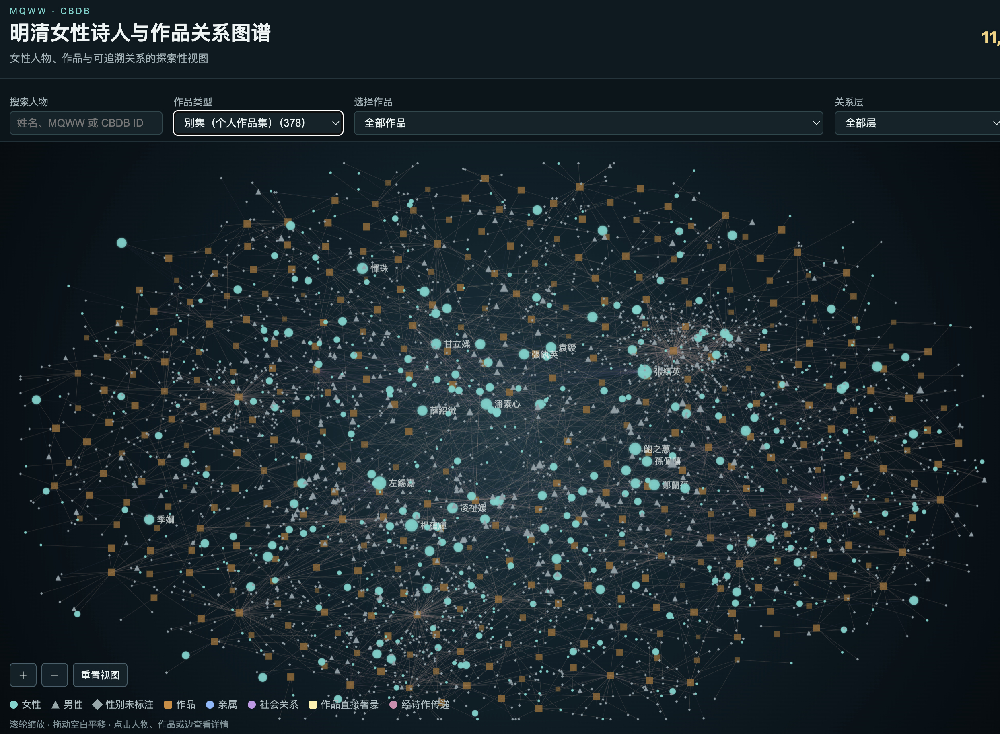
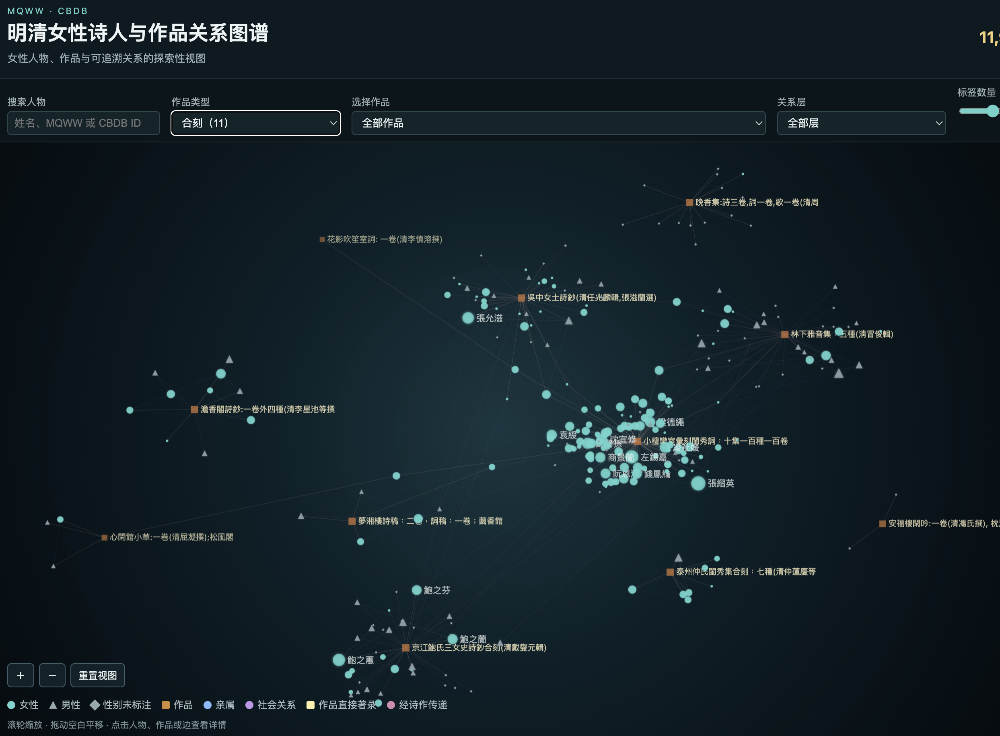
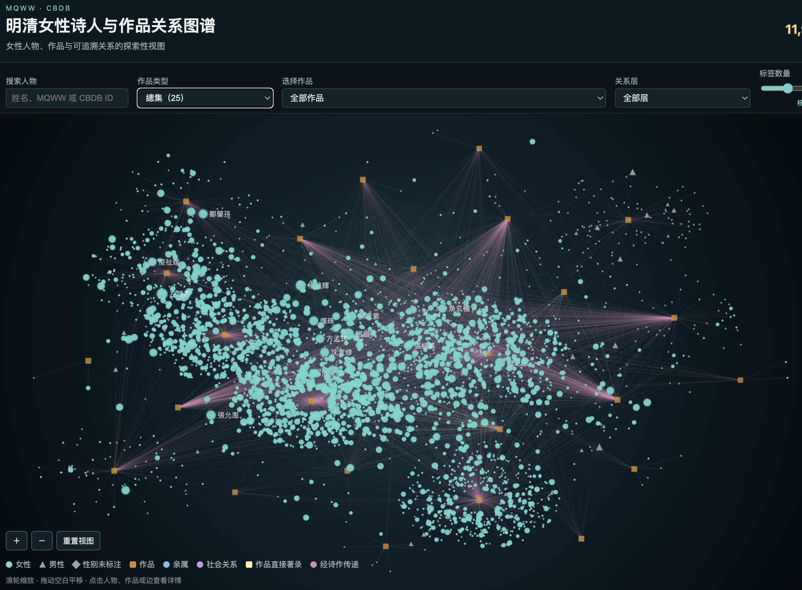

# MQWW × CBDB 女性人物与作品关系网络

本项目以 MQWW（明清妇女著作）女性人物为主体，尝试匹配 CBDB 人物 ID，提取亲缘与社会关系，并以作品为入口探索女性人物之间的分层关系网络。

## 在线网站

GitHub Pages：<https://sousekil.github.io/women-poets-imperial-china/>

如果页面刚刚更新，GitHub Pages 可能需要几分钟完成部署。

### 网络可视化示例

**别集类型（378 部作品 / 约 3,043 人）**


**合刻类型（11 部作品 / 270 人）**


**总集类型（25 部作品 / 3,618 人）**


## 可视化特点

- **纯静态网站**：无构建系统，HTML + Canvas 直接渲染；
- **人物搜索**：按中文姓名、MQWW ID 查找；
- **作品筛选**：选择特定作品，高亮关联人物；
- **关系层级**：区分 CBDB 直接关系与 MQWW 作品/诗作传递关系；
- **详情面板**：显示匹配等级、置信度、来源数据库和推导规则；
- **数据溯源**：所有节点和边保留原始记录 ID、匹配级别和派生逻辑。

## 数据来源与研究口径

**数据来源：**

- CBDB 2024-09：Harvard University、Academia Sinica 与 Peking University, China Biographical Database (CBDB). <https://cbdb.hsites.harvard.edu/>
- MQWW 2023：McGill University Library / Academia Sinica, Ming Qing Women's Writings. <https://mhdb.mh.sinica.edu.tw/mingqing/mqww/>

**研究口径：**

- 姓名相同不是同一人物的充分证据；后续连接使用 `poetID` / `c_personid`；
- CBDB 亲缘/社会关系、MQWW 直接作品关系、作品—诗作—人物传递关系分层显示；
- 共同收录不等于现实社会关系；
- 网络中心度表示数据库记录中的连接结构，不直接等同于历史影响力；
- 匹配候选、来源记录、置信度和推导规则应保留，以便复核。

## 仓库结构

```
.
├── index.html              # 静态网站入口
├── assets/                 # 样式与 JavaScript
│   ├── app.js
│   └── style.css
├── data/
│   └── derived/           # 派生数据（不含原始数据库）
│       └── network/
│           ├── network_nodes.csv
│           ├── direct_edges.csv
│           ├── work_nodes.csv
│           └── work_person_edges.csv
├── python/                # 只读数据处理脚本和测试
│   ├── match_mqww_cbdb.py
│   ├── match_mqww_cbdb_l2.py
│   ├── build_network_derived.py
│   └── test_*.py
└── docs/                  # 项目文档
    ├── data_dictionary.md
    ├── matching_method.md
    ├── mvp_handoff.md
    └── HANDOFF.md
```

## 本地运行

### 1. 启动网站

```bash
python3 -m http.server 8877
```

然后打开 <http://127.0.0.1:8877/>。

### 2. 重新生成派生数据

```bash
python3 python/match_mqww_cbdb.py
python3 python/match_mqww_cbdb_l2.py
python3 python/build_network_derived.py
```

### 3. 运行测试

```bash
PYTHONPATH=python python3 -m unittest discover -s python -p 'test_*.py' -v
```

**注意：** 脚本读取仓库外部的原始资料目录；当前本机开发路径只记录在项目文档中，公开 clone 需按 `data/README.md` 配置等价的本地资料副本。原始 CBDB SQLite、MQWW Access 和全量原始 CSV 不在本仓库中，也不应上传到 public GitHub。脚本以 SQLite read-only URI 和 `PRAGMA query_only=ON` 读取 CBDB。

## 许可与引用

项目自有代码和文档以 [MIT License](LICENSE) 发布；CBDB、MQWW 与派生数据仍受各自来源条款和署名要求约束。

---

## English

# MQWW × CBDB: Women Poets Network

This project builds a layered relationship network centered on women poets from MQWW (Ming Qing Women's Writings), matched with CBDB person IDs to extract kinship, social associations, and work-based connections.

## Live Site

GitHub Pages: <https://sousekil.github.io/women-poets-imperial-china/>

Deployment may take a few minutes after updates.

### Network Visualization Examples

**Bieji (Individual Collections): 378 works / ~3,043 people**


**Heke (Compiled Collections): 11 works / 270 people**


**Zongji (Anthologies): 25 works / 3,618 people**


## Visualization Features

- **Pure Static Website**: No build system, direct HTML + Canvas rendering;
- **Person Search**: Find by Chinese name or MQWW ID;
- **Work Filtering**: Select a specific work to highlight connected people;
- **Layered Relationships**: Distinguish CBDB direct edges from MQWW work/poem propagated edges;
- **Detail Panel**: Shows match level, confidence, source database, and derivation rules;
- **Data Provenance**: All nodes and edges retain original record IDs, match levels, and derivation logic.

## Data Sources & Research Scope

**Data Sources:**

- CBDB 2024-09: Harvard University, Academia Sinica, and Peking University, China Biographical Database (CBDB). <https://cbdb.hsites.harvard.edu/>
- MQWW 2023: McGill University Library / Academia Sinica, Ming Qing Women's Writings. <https://mhdb.mh.sinica.edu.tw/mingqing/mqww/>

**Research Scope:**

- Name match is not sufficient proof of identity; subsequent connections use `poetID` / `c_personid`;
- CBDB kinship/association relationships, MQWW direct work relationships, and work→poem→poet propagated relationships are displayed in separate layers;
- Co-occurrence in databases does not equal real-world social relationship;
- Network centrality reflects record structure, not necessarily historical influence;
- Match candidates, source records, confidence scores, and derivation rules are preserved for verification.

## Repository Structure

```
.
├── index.html              # Static website entry
├── assets/                 # Styles and JavaScript
│   ├── app.js
│   └── style.css
├── data/
│   └── derived/           # Derived data (no raw databases)
│       └── network/
│           ├── network_nodes.csv
│           ├── direct_edges.csv
│           ├── work_nodes.csv
│           └── work_person_edges.csv
├── python/                # Read-only data processing scripts and tests
│   ├── match_mqww_cbdb.py
│   ├── match_mqww_cbdb_l2.py
│   ├── build_network_derived.py
│   └── test_*.py
└── docs/                  # Project documentation
    ├── data_dictionary.md
    ├── matching_method.md
    ├── mvp_handoff.md
    └── HANDOFF.md
```

## Local Usage

### 1. Launch Website

```bash
python3 -m http.server 8877
```

Then open <http://127.0.0.1:8877/>.

### 2. Regenerate Derived Data

```bash
python3 python/match_mqww_cbdb.py
python3 python/match_mqww_cbdb_l2.py
python3 python/build_network_derived.py
```

### 3. Run Tests

```bash
PYTHONPATH=python python3 -m unittest discover -s python -p 'test_*.py' -v
```

**Note:** Scripts read external source data directories; current local development paths are documented in project docs. Public clones require equivalent local copies per `data/README.md`. Original CBDB SQLite, MQWW Access, and full raw CSVs are not in this repository and should not be uploaded to public GitHub. Scripts use SQLite read-only URI and `PRAGMA query_only=ON` to access CBDB.

## License & Citation

Project code and documentation are released under [MIT License](LICENSE); CBDB, MQWW, and derived data remain subject to their respective source terms and attribution requirements.

[Back to 中文](#mqww--cbdb-女性人物与作品关系网络)
